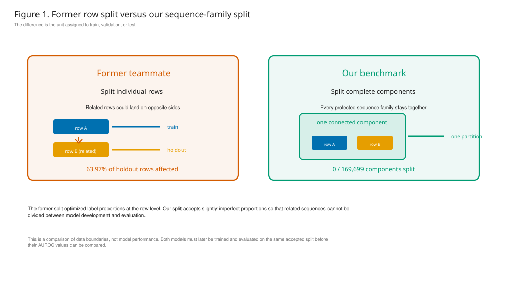
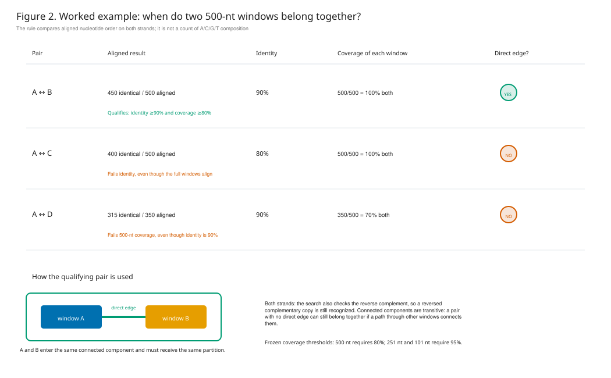
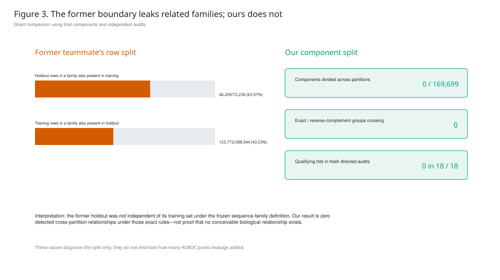
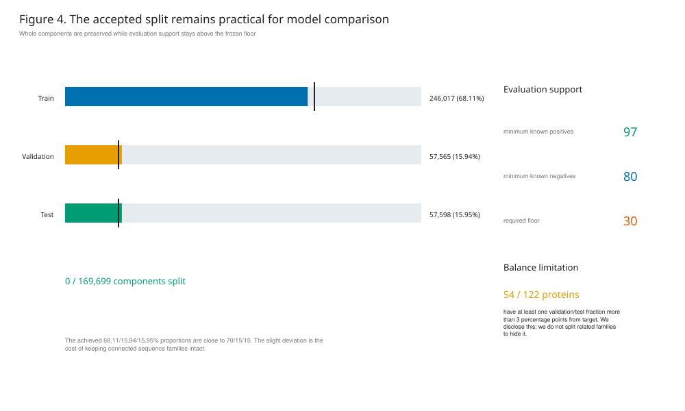

# Task 003A — Why we replaced the former data split

## One-sentence conclusion

The former teammate split individual rows, allowing closely related sequences to appear in both training and evaluation; our split assigns complete sequence families and passed every frozen leakage audit.

| Question | Former teammate | Our accepted benchmark |
|---|---|---|
| What is assigned? | Individual rows | Whole connected sequence components |
| Can related rows cross the boundary? | Yes | No under the frozen rules |
| Holdout rows in a family also seen in training | **46,209/72,236 (63.97%)** | **0 split components** |
| Independent similarity audit | Not protected by construction | **0 hits in 18/18 searches** |
| Exact/reverse-complement groups crossing | Not protected by construction | **0** |
| Final proportions | 80% train / 20% holdout | 68.11% train / 15.94% validation / 15.95% test |

## 1. Direct comparison

## 2. A concrete 500-nt example

Sequence identity is the fraction of aligned nucleotide positions that match in order. For a 500-nt pair, 450 matching aligned positions means 90% identity. A direct edge also requires enough of both windows to align: at 500 nt the frozen threshold is 80% bidirectional coverage. The search checks the forward sequence and its reverse complement.

A qualifying pair is placed in the same connected component. Components are transitive: if A is related to B and B to C, all three stay together even if A and C do not directly qualify.

## 3. What the audit found

When the former fold is evaluated using the final sequence-family definition, **46,209/72,236 former holdout rows (63.97%)** and **125,772/288,944 former training rows (43.53%)** belong to components crossing that old boundary.

Our final split contains zero divided components, zero cross-partition exact/reverse-complement groups, and zero qualifying hits in all 18 fresh directed searches.

## 4. Is the replacement usable?

Yes. It contains 246,017 train, 57,565 validation, and 57,598 test rows. The minimum evaluation support is 97 known positives and 80 known negatives per protein, above the floor of 30.

The tradeoff is disclosed: 54/122 proteins have at least one validation/test fraction more than 3 percentage points from target. We do not divide related families merely to improve these percentages.

## What this establishes

- The former fold is not leakage-safe under the frozen sequence rules.
- The final split is deterministic, whole-component, and passed the prespecified structural, exact/RC, and 18 directed similarity audits.
- No cross-partition relationship was detected under the frozen 500/251/101-nt rules.
- Per-protein label imbalance remains and is reported explicitly; evaluation support remains above the prespecified count floor.

## What this does not establish

- The audit does not quantify how much the former AUROC was inflated.
- It does not prove that no biological or coordinate relationship exists outside the frozen rules.
- It does not establish model performance, generalization, or superiority over competitors.
- Composition similarity is descriptive and is not proof that every possible sequence covariate is balanced.

## Reproducibility

All headline values originate from machine-readable tables in the Task 003A artifact package. The internal construction history, edge intersections, component distributions, per-protein heatmap, and sequence-composition checks remain available in the technical appendix. The largest composition effect is small/borderline (|SMD|=0.101; maximum KS D=0.057). Input hashes, output hashes, software versions, and reconciliation gates are recorded in `provenance.json` and `manifests/task003a_split_validation_report.json`.
