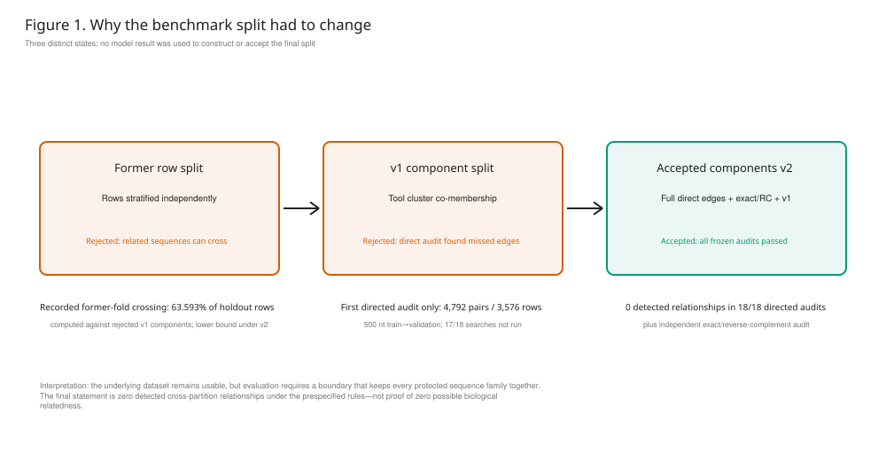
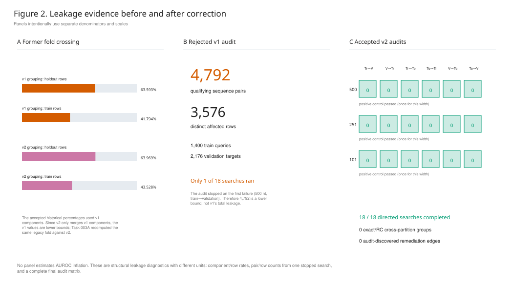
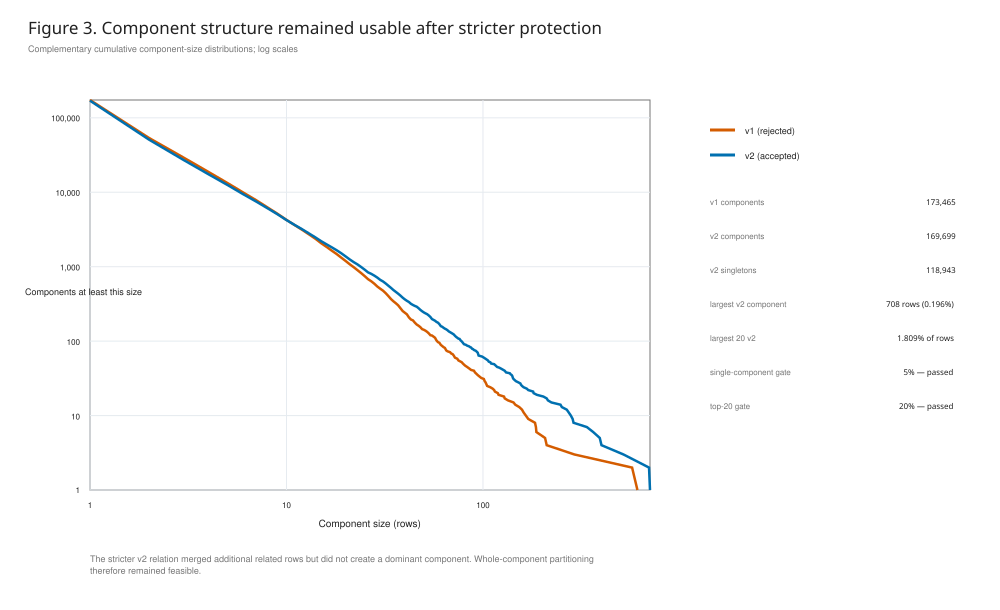
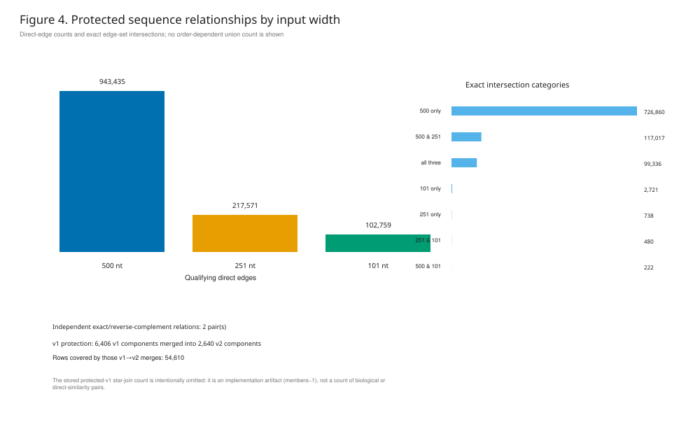
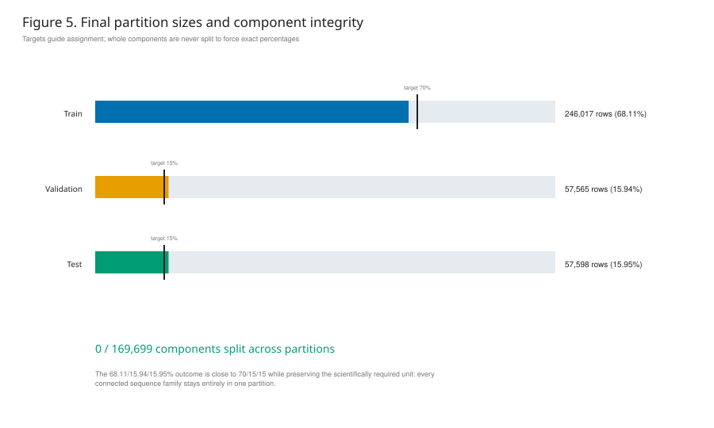
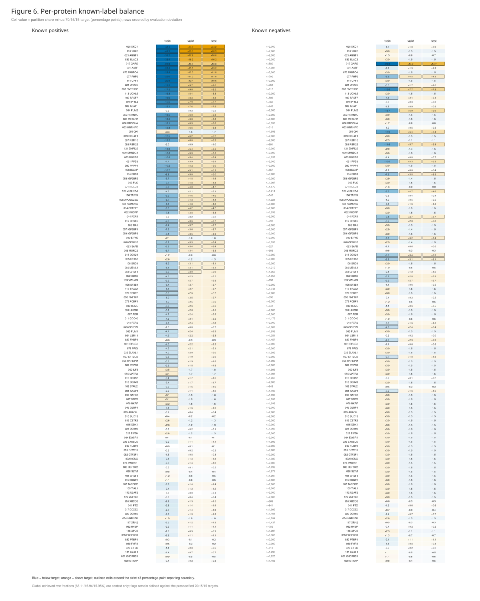
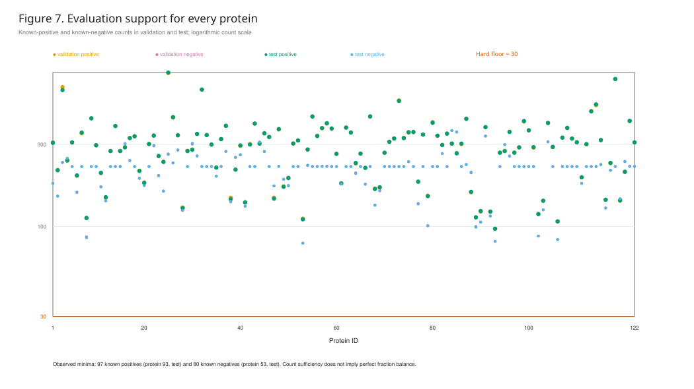
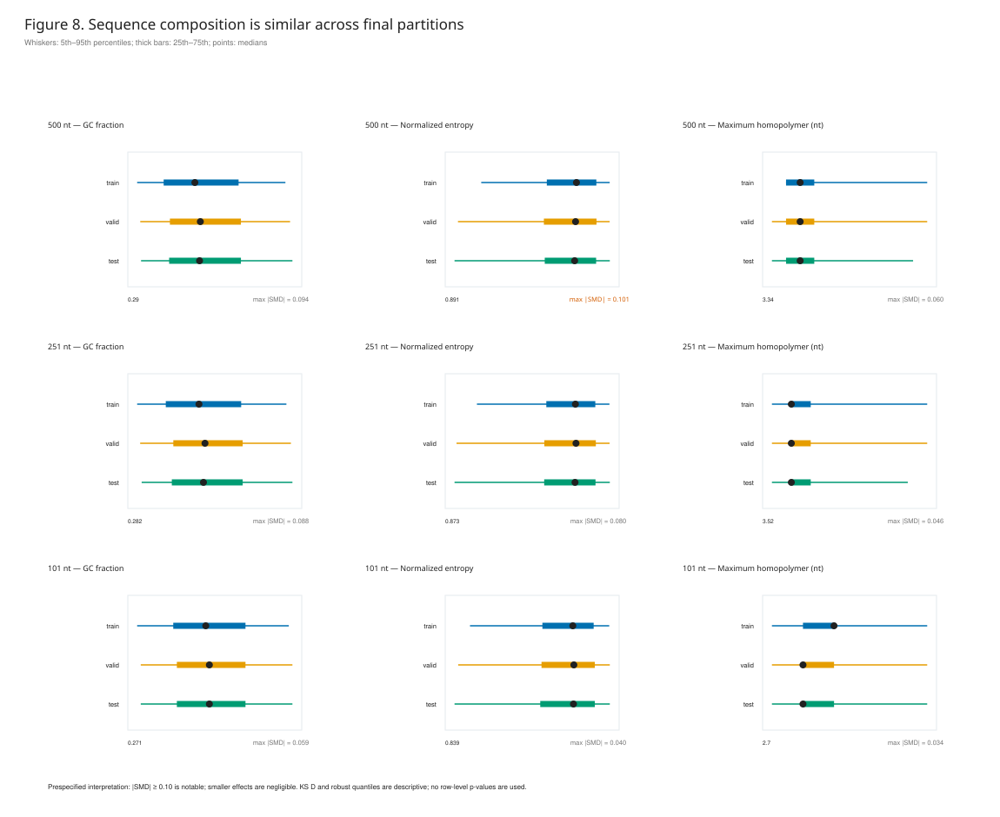

# Task 003A — Supervisor split-validation report

## Executive conclusion

The original row-level fold is not suitable as an unbiased benchmark boundary because related sequences occur on both sides. The accepted components-v2 split keeps every protected sequence family together and passed all prespecified structural and independent leakage audits. No model prediction or performance metric was used to build or accept this split.

- Final universe: **169,699 components across 361,180 rows**.
- Final partition sizes: **246,017 train / 57,565 validation / 57,598 test**.
- Component integrity: **0/169,699 components split**.
- Independent exact/reverse-complement audit: **0 cross-partition groups**.
- Fresh directed similarity audits: **0 qualifying cross-partition hits in all 18/18 searches**, with positive controls passing once per width.
- Evaluation support: minimum **97 known positives** and **80 known negatives** per protein in validation/test (required floor: 30).

## 1. Why the former fold was rejected

The former notebook's exact fold 0 was reproduced using its pinned dependency stack, seed, and positive-only stratification matrix. Against the rejected v1 grouping, **45,937/72,236 holdout rows (63.593%)** and **120,760/288,944 training rows (41.794%)** belonged to components crossing the boundary.

Task 003A separately recomputed that same frozen fold against final v2 membership: **46,209/72,236 holdout rows (63.969%)** and **125,772/288,944 training rows (43.528%)** are in crossing v2 components. This new value does not replace the historical v1 result; it answers the final-relation question directly.

## 2. Independent leakage evidence

The intermediate v1 assignment was also rejected. Its first directed audit (500 nt, train→validation) found 4,792 qualifying pairs among 3,576 distinct rows (1,400 train queries and 2,176 validation targets). The audit stopped there by design, so 17/18 searches were not run and 4,792 is a lower bound—not a total v1 leakage count.

Components v2 were constructed from the complete direct-edge relation, exact/reverse-complement relations, and protected v1 co-membership. The final audit regenerated partition FASTAs and databases, passed positive controls, and completed all 18 width/direction searches with zero violations.

## 3. Component structure and protected relationships

The stricter relation produced 169,699 components. The largest contains 708 rows (0.196%), and the largest 20 together contain 1.809% of rows—well below the prespecified 5% and 20% stop gates.

## 4. Final partition and label support

The achieved fractions are 68.11%/15.94%/15.95% versus 70%/15%/15% targets. Whole components were never split merely to hit exact percentages.

Known-label balance is disclosed rather than hidden: 86/122 proteins have at least one protein×class×partition cell more than 3 percentage points from the 70/15/15 target (218/732 cells). Restricting attention to validation/test gives 54 proteins and 117 cells. These are fraction-balance flags; every evaluation cell still exceeds the count floor.

## 5. Sequence-composition check

GC fraction, normalized mononucleotide entropy, and maximum homopolymer length were compared among final partitions at all three protected widths. The largest observed absolute standardized mean difference was **0.101** (normalized_entropy, 500 nt, train versus test). It is only 0.001 above the prespecified |SMD|≥0.10 reporting boundary and remains small in magnitude. The largest KS D was **0.057** (gc_fraction, 500 nt, train versus validation). Quantiles and KS D are descriptive; rows within components are not independent, so no row-level p-values are used.

## Allowed claims

- The former fold is not leakage-safe under the frozen sequence rules.
- The final split is deterministic, whole-component, and passed the prespecified structural, exact/RC, and 18 directed similarity audits.
- No cross-partition relationship was detected under the frozen 500/251/101-nt rules.
- Per-protein label imbalance remains and is reported explicitly; evaluation support remains above the prespecified count floor.

## Claims not supported

- The audit does not quantify how much the former AUROC was inflated.
- It does not prove that no biological or coordinate relationship exists outside the frozen rules.
- It does not establish model performance, generalization, or superiority over competitors.
- Composition similarity is descriptive and is not proof that every possible sequence covariate is balanced.

## Reproducibility

All headline values originate from machine-readable tables in the Task 003A artifact package. Input hashes, output hashes, software versions, runtimes, and reconciliation gates are recorded in `provenance.json` and `manifests/task003a_split_validation_report.json`. The accepted split was not changed.
